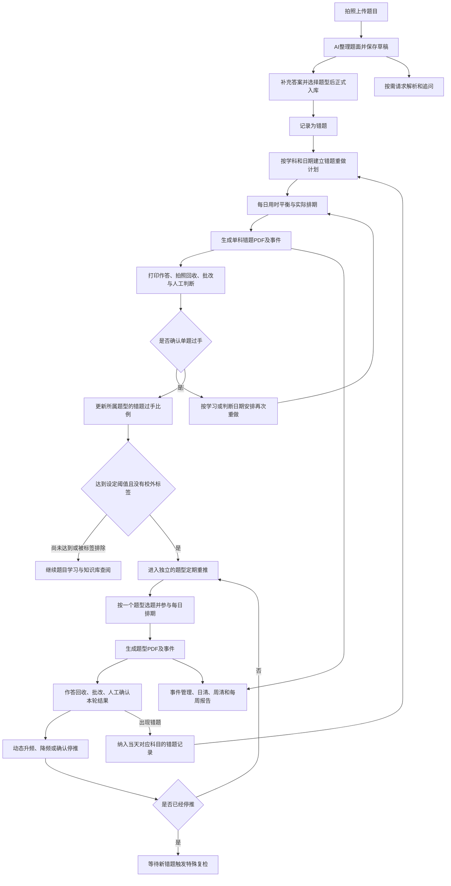
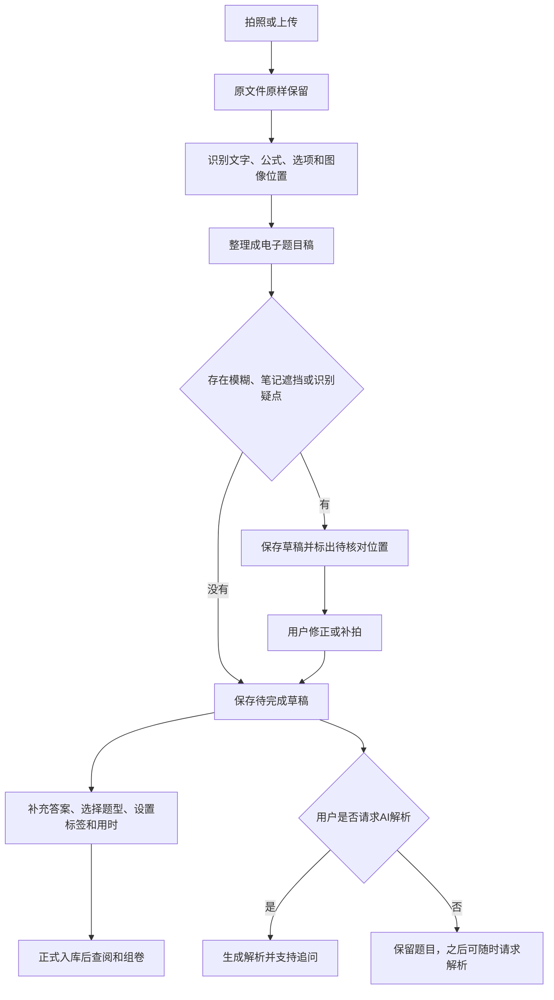
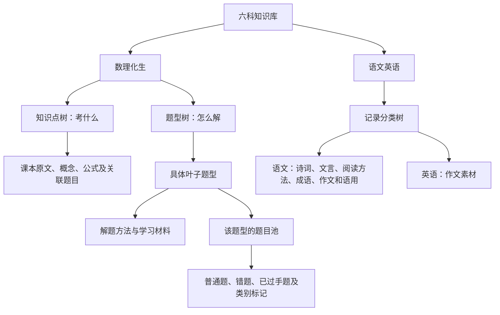
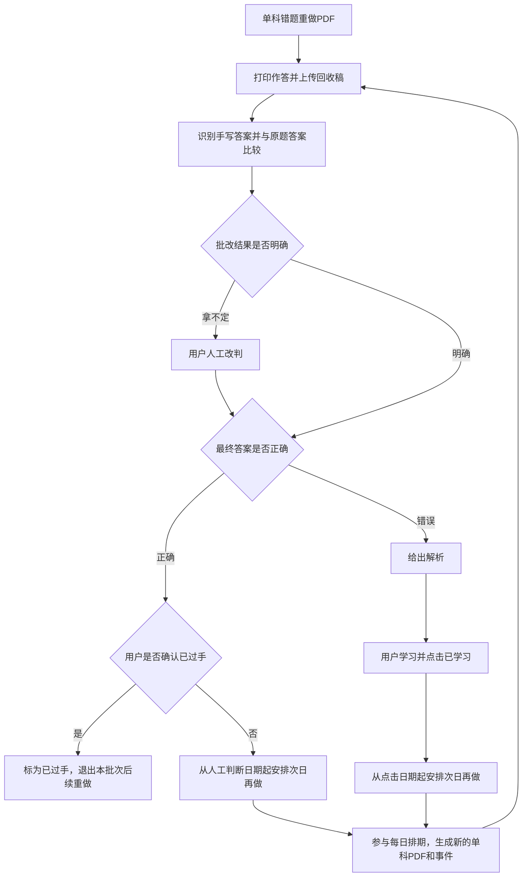
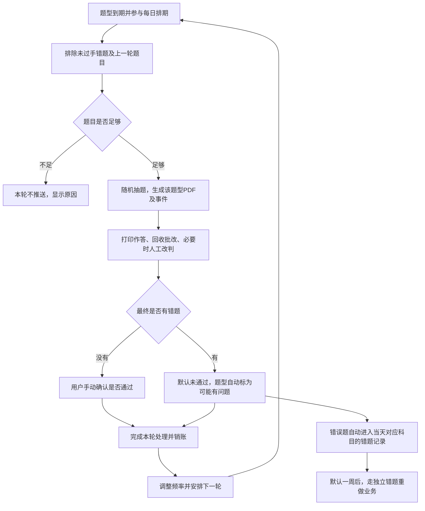
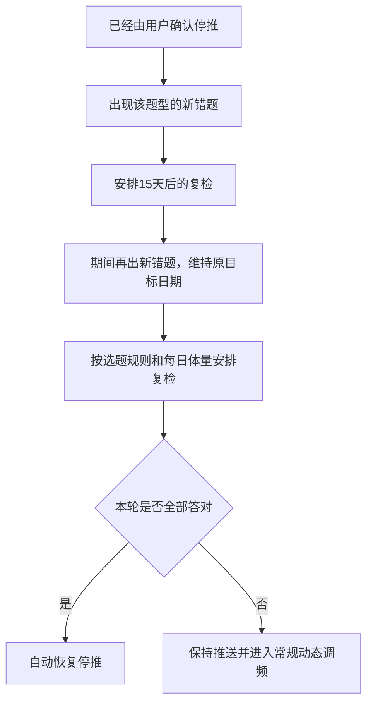
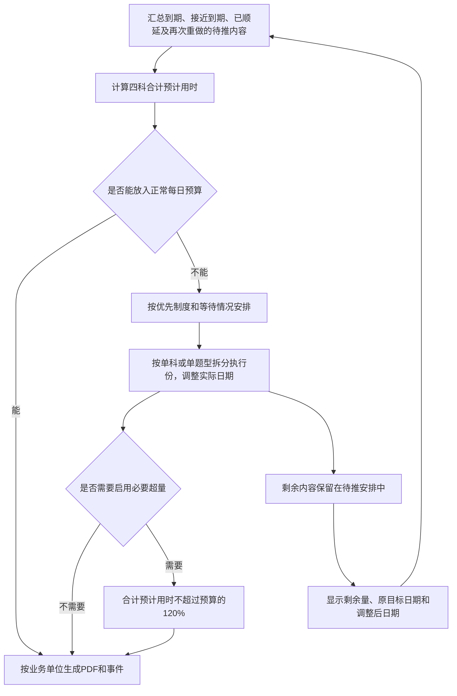
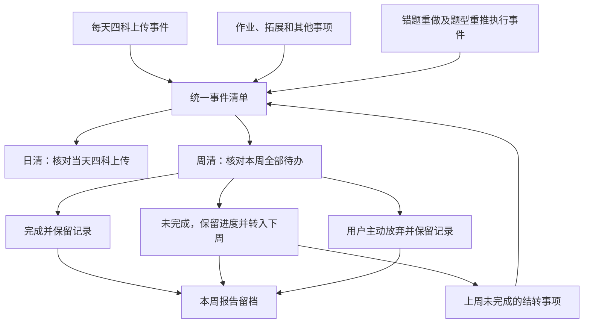

# 项目意图推断 · 功能逻辑与用户使用链路

维护日期：2026-10-23

2026-10-24更新：题库、自由组卷、选用题型重推、英语单词与提醒的最新确认规则见《2026-10-24-题库与复习系统架构》。题型重推现为默认关闭的选用功能，须总开关与叶节点开关同时开启；下文原有调频规则仅在启用后适用。英语单词采用独立额度，不占四科练习预算。

文档定位：保留项目业务规则与长期功能范围，不作为所有功能均已实现的承诺。当前入口、运行依赖和验证方式见项目根目录 README.md。

本文件整理项目的功能、用户操作、判断条件和业务衔接。已确认的规则作为业务依据，尚未核定的功能按文末范围表逐项讨论。-2 正式版默认本地 OCR，公式或重叠笔迹不可靠时保留原图供人工校对；文中识别及自动清理表示目标流程，不保证无损全自动转录。

## 1. 项目目标与完整主链

项目服务于高中六科学习。数理化生的主线是：记录题目与错题，按题型整理知识，重做错题并确认单题过手，再定期检验题型是否仍然掌握。语文英语知识库用于积累与查阅。

错题重做和题型重推是两个独立业务。错题重做解决具体题目的掌握问题；题型重推检验整个题型的掌握情况。它们共同使用题目、PDF、批改、事件管理与每日用时安排，但不混用选题条件、周期、去重要求及销账条件。

这条主链不是“全部错题解决后才允许使用知识库”。题目归档后即可查阅、追问、整理方法和手动组卷。达到过手比例，只是进入题型定期检测的条件。

## 2. 用户的主要使用入口

沿用原有五个功能入口，描述功能归属，不划定具体页面实现方式。

| 入口 | 用户在这里做什么 |
| --- | --- |
| 主页 | 查看今日事件、待做PDF、待回收与待判断事项、日清进度和顺延情况 |
| 拍题与对话 | 上传题目、查看整理稿、按需解析、追问、通用对话以及提交作答回收稿 |
| 知识库 | 查看知识点、题型方法、题目池和语文英语积累；归类、筛选、导入与手动组卷 |
| 学习计划与事件管理 | 记录作业和拓展；处理上传、错题重做、题型重推事件；查看日清、周清与历史报告 |
| 设置 | 修改错题初次重做间隔、题型过手阈值、升降频轮数、每日用时预算及学科优先制度等 |

## 3. 题目输入、整理与正式入库

### 3.1 用户操作

1. 拍照或上传题目图片。
2. AI识别题干、公式、选项、小题编号，自动分离示意图及标注，清理独立手写笔记并增强图像。
3. 整理结果保存为待完成草稿，同时保留上传原件；草稿不进入知识库、组卷或错题重做排期。
4. 用户可以随时修改识别错误、调整裁图或补拍。
5. 答案来源任选手动输入／拍照、答案库提取、AI作答；人工提供的内容直接视为已确认，AI作答必须同时有解析与答案并经人工确认。
6. 沿用归类逻辑，数理化生正式入库前必须选择本学科的一个叶子题型。知识点关联及自定义标签可选。用时默认人工输入，可选AI预估并自行采纳。
7. 补充答案内容、保存归类与用时后，点击“完成并正式入库”。录入时勾选的错题在此时才形成错题记录。

### 3.2 带图、带笔记和杂乱题面的处理

| 情况 | 处理逻辑 |
| --- | --- |
| 题干、选项、公式 | 转为可编辑和排版的内容 |
| 几何图、电路图、函数图、实验图等 | 裁取原题图像，完整保留字母、刻度、图例、连接点等题目条件，并放入对应位置 |
| 一题多图 | 保留原顺序及图甲、图乙等标识 |
| 外围笔记 | 在题面完整的前提下裁去 |
| 笔记与题干混杂 | 能区分的印刷题干整理为文字；无法区分的部分保留图片并标疑点 |
| 笔记遮挡条件或图线 | 保留受影响区域，提示核对或补拍，不猜造缺失内容 |
| 独立手写笔记 | 自动定位并清理，印刷题干、公式、图中标注保留；与题目重叠且不能分离的笔迹标疑点，不猜造遮挡信息 |
| 图像增强 | 自动生成对比度及锐度增强副本，保留与原图的对照，不覆盖原件 |

原件保存与整理稿保存分别进行。旋转、裁剪、压缩、去笔记等操作生成副本，不改变上传的原文件。拍摄时已经模糊、缺边或被遮住的信息，需要核对或补拍。

草稿保存表示材料已经保存，不表示正式入库或识别完全正确。有疑点的题持续显示待核对位置，用户可回看原图。题目照片里的手写作答、笔记不直接认定为标准答案；主动通过答案入口提供的照片属于人工答案。

### 3.3 解析、标准答案与题目修正

AI解析仍由用户主动请求，不是选择人工答案时的必经步骤。给AI的要求明确同时生成完整解析及最终答案，不完整的输出不作为答案草稿保存。

三个答案来源并列供用户自行选择。手动输入／拍照、答案库提取属于人工提供的已确认内容，不经AI判断正确性，不强制答案与解析两项齐全，也无需再勾选确认。AI演算的答案和解析需要用户人工确认后才能正式入库，并作为批改依据。

### 3.4 整页答案库

答案库支持整页照片及PDF，多页可以一起录入。整页原件、PDF原文件均保留；系统建立资料名、版本、章节、题号与答案区域的对应索引，只定位并转录已有答案，不自行解题或改写答案。

用户输入资料名、章节和题号后，选择匹配资料，系统从整页裁切对应题目的完整答案与解析。跨栏、跨页内容保留多个裁片及原页引用。多个匹配结果展示供用户选择；未匹配时提示用户检查索引或选择其他来源。题号、章节和裁切范围可以手动调整。未配置AI也可先保存原页并手动标注。

题面修正、答案补充保留历史材料。已经生成的卷保持原先对应的题目与答案依据，避免后来修订使旧卷内容和批改依据错位。

## 4. 知识库架构与知识沉淀

本节按2026-10-23确认的知识树逻辑更新。正式网页与树形示例采用同一业务口径；知识内容整理与导入仍由用户选择落点和确认收录。

### 4.1 数理化生：两棵独立的树

知识点树回答“考什么”，用于保存原文、概念、公式等。题型树回答“怎么解”，保存某个解法模型的方法材料和具体题目。

树的层级可自由组织，不要求固定章、节或模块齐全。每个节点都可保存笔记与痛点；新增题目归属须选叶子题型，知识点关联可选择分类或叶子节点。点击节点上的加号创建子分支，点击根分支按钮创建根节点；新增窗口只填标题，位置由入口确定，其余创建后编辑。

已经挂题的节点允许直接新增子分支，不要求立即迁移。其直接挂载题目保留原归属，显示“有问题／归属待调整”，包含关联草稿；可随后逐题选择同学科叶子题型，允许只迁移一部分。调整归属不复制题目、不修改做题历史或既有卷面快照。非叶题型不新进入题型检测，普通错题重做仍按原业务继续。父节点的题目池汇总自身及后代，同一道题仅显示一次；草稿另页筛选，不参与正式题目池统计或检测。

每道数理化生题目有一个主要题型归属，可以关联多个知识点，也可以说明它是某个模型的变式。暂时拿不准归属的题可以保存为草稿，选择叶子题型后才能正式入库。已有历史题目保留原数据，不强制补填。

### 4.2 一个题型里有什么

| 内容 | 功能 |
| --- | --- |
| 笔记 | 方法、模型、公式和学习材料统一为独立条目；支持标签、原图及多条置顶 |
| 痛点 | 每个具体问题作为独立条目保存、阅读、编辑，可置顶 |
| 下级目录 | 有子节点时显示，点击后打开对应节点 |
| 题目池 | 保存属于该题型的全部题目，支持查阅、标记、筛选、组卷和检测 |

节点以完整弹窗展示，左侧目录每次只显示一个栏目页面；笔记、痛点每条正文独立阅读，不拉通展示全部正文。删除“总览”和“错题过手进入条件”目录；检测条件保留在业务计算中。没有历史错题时过手比例为空，不视作100%。

题目是可复用的独立内容。知识树、错题筛选、重做卷和题型检测卷都关联同一道原题，不各自复制一份题目。

### 4.3 题目状态与标签

题目可以是非错题、尚未过手的错题、已过手的题。重点题、模板题、难题是类别标签，可与掌握状态同时存在。曾经做错的事实保留，用于理解掌握情况及选题。

笔记标签、题目标签、节点标签分别管理。编辑时从已有标签中多选，也可新建自定义标签后选择。笔记列表显示条目标签；题目池显示题目标签，并按单一标签或未设标签筛选，可与题目状态组合。筛选计数基于当前范围全部题目，先筛选后分页。

题型使用通用标签功能，其他题型标签不额外赋予特殊推送含义。默认提供“校外”标签；带该标签的题型不参与题型重推。校外题型标签不自动替用户放弃另一个业务中的既有错题重做事件。

题目上的重点题、难题标签参与抽题概率调整；题型上的普通分类标签不自动套用该权重。

### 4.4 归类与内容来源

题型和知识点归类时提供已有名称的匹配提示，用户可选择、修改或新建，减少同一题型被不同写法拆散。既有归类可由用户调整，拿不准的内容保留在待归类清单。

知识内容可以来自用户手写或输入、照片、外部资料、本应用对话及外部聊天记录。AI整理为可编辑内容，用户确认收录位置后保存。数理化生对话整理的概念、步骤、方法和示范片段可以归入指定题型的学习材料；示范片段只有另行作为题目录入后，才进入题目池。

笔记图片上传独立于拍题识别：多张原文件直接保存，不做识别、压缩或重编码，可仅图片成条目；支持原始尺寸查看和原图下载。外部资料或AI整理的文字需勾选校对确认。正式网页知识库备份包含节点、条目、标签及原图；导入合并节点并覆盖同ID条目，不替换题库、题史和排期。

### 4.5 语文英语与其他原有功能

语文英语采用记录分类树，主要用于积累与查阅。语文保存诗词、文言、阅读方法、成语、作文和语用；英语知识库保存作文素材。两科题目仍可输入、解析、追问、标记和手动组卷，但不套用本文件的四科题型重推链。

知识点记背、英语独立词库与单词过关属于原有功能。本轮没有重新核定它们的周期、事件归属以及与统一推送形式的关系，暂不将旧周期或旧推送方式作为新规则，也不计入本文件已经确定的四科题目推送预算。语文文言、古诗专门过关机制仍待另行讨论。

## 5. 错题记录与独立的错题重做业务

### 5.1 错题来源与批次日期

| 来源 | 记录方式与日期依据 |
| --- | --- |
| 用户拍照录入并标为错题 | 按上传日期，进入该日期对应学科的错题批次 |
| 题型重推发现错误 | 自动纳入发现错误当天对应学科的错题记录，以当天作为本次错题记录日期 |

同一道旧题在题型检测中再次出错，保留与原题的联系，新增本次错题发生的记录，不要求重新拍摄原题，也不把它的旧上传日期当作本次重做起点。

### 5.2 首次重做

默认在批次日期一周之后重做，用户可修改初次间隔。原定范围是该日期、该学科的全部错题。

每日体量机制允许把范围拆分到多天，不丢掉未排入的题，也不因日期窗口过去就把它们排除。每次执行以一个科目为单位，保留所含题目的原批次信息。

生成题目PDF和对应事件，用户打印、手写作答、拍照回收。首次重做不采用题型重推的随机抽题和上一轮硬排除规则。

### 5.3 批改、人工改判与单题过手

正确与过手是两层判断。答案正确仍需用户确认过手；答对但认为尚未掌握的题也要继续重做。答案错误则给出解析，用户点击“已学习”后安排次日再做。“已学习”不等于已过手。

答案拿不定、手写识别不清或缺少可用标准答案时，进入人工处理，不直接判错或判对。用户可以修正误判，再进入相应分支。

次日是目标日期；在每日用时安排下可以调整，实际日期和顺延量须可见。

### 5.4 每轮事件销账

每轮重做是独立事件。所有题目的判定处理完，正确题完成过手判断，错误题都点击“已学习”，本轮事件销账。未过手题产生后续重做安排，新的执行份生成新事件。

没有完成判断或没有点击“已学习”的题保留待处理。放弃事件是单独的结束结果，不把题自动认定为过手。

## 6. 过手比例达标后，进入独立的题型重推

### 6.1 进入条件

以某个题型下曾经记录为错题的题目为统计范围，每道题只计一次。已过手错题包括当前已确认掌握的历史错题，未过手错题仍在分母中；重复做错不把同一道题重复计成多个题目。

**已过手错题数 ÷ 该题型总错题数，达到或超过设定阈值，就算题型已解决。阈值默认80%，用户可修改。**

达到条件的题型进入定期重推，初始间隔为7天。仍未过手的那部分错题继续走独立错题重做，排除在题型随机抽题范围之外。

没有历史错题时，比例没有可用判断依据，不伪算为100%；这种题型的人工启用入口不在本轮已确认规则中。带“校外”标签的题型不进入推送。

已经进入检测的题型不会因检测出错或比例暂时下降就自动暂停。后续按题型检测结果、频率及停推规则处理。

### 6.2 选题范围与概率

候选是该题型下的全部题目，先排除尚未过手的错题，再排除上一轮推送过的全部题目。剩余题目不足以满足本轮安排时，本轮不推送，不为凑数重复抽取上一轮题目。

每轮默认至少抽取2题，用户可在设置中修改最低题数。排除后可用题目不足最低题数时，本轮不推送；实际题数仍由每日预计用时与可用题库共同决定。

在可用题目中随机抽取：重点题、难题提高概率；曾错过的题倾向提高概率；从未成为错题的普通题倾向降低概率；推送中已答对的题倾向降低概率。

正误记录发生重叠时，更近的作答结果为主要依据，旧结果影响较小。近期正误表现与重点题、难题类别因素的重要性相当，近期结果不覆盖类别因素。

去重仅作用于这个题型业务：上一轮题型检测的题不得进入下一轮题型检测；它不阻止独立错题重做在次日再次使用同一道题。

### 6.3 回收、判断与错误处理

常规题型检测是否通过由用户手动确认，全部答对不自动认定通过；有错题默认未通过。无法可靠批改的题先处理人工改判，再使用最终结果。

出现错误后自动标为“可能有问题”，错误题纳入当天该科错题记录，题型检测不暂停。之后一轮由用户确认通过，即解除“可能有问题”。

题型重推一轮做完即销账，不等其中错误题在另一个业务里全部过手。另一个业务的事件分别记录和处理。

## 7. 题型重推的动态周期与停推复检

### 7.1 常规调频

频率档位只有：**3天一次、7天一次、15天一次、不推**。初始为7天一次。

| 检测情况 | 调控结果 |
| --- | --- |
| 连续答对达到降频条件，且本轮用户确认通过 | 向更低频率调整一档 |
| 连续出错达到升频条件 | 向更高频率调整一档，最高3天一次 |
| 全对但用户确认未通过 | 保持频率，保留连续答对记录；即使达到条件，本轮也不降频 |
| 达到从15天转为不推的条件 | 请求用户确认；确认后停推，未确认不擅自停推 |
| 待回收、待批改或待人工判断 | 尚无本轮完整结果，不据此自动调频 |
| 题池不足而没有实际推送 | 不计作一轮答对或答错 |

升频、降频默认各以连续2轮为触发条件，分别保留设置入口。常规出错打断连续答对，常规全对打断连续出错；完成一次档位调整后重新累计。全对但人工未通过按上表处理，不清除已有连续答对记录。

下一轮从上一轮处理完成的日期起，按当前档位计算目标时间。每日体量安排可以调整实际日期，但不把实际顺延另命名为新的频率档位。等待本轮处理时，不提前把未完成轮次当作结束来计算下一轮。

### 7.2 停推后的特殊复检

停推题型出现新错题，自动恢复最低频率，从首次新错题记录当天起安排15天后的复检。等待期间又出现新错题，维持已确定的复检目标日期，不反复延后。

复检一轮全部答对，自动恢复停推；有错误则保持推送、标为“可能有问题”，继续常规动态调频。全对自动停推只属于这一特殊复检分支，常规检测仍需用户确认通过。

校外标签的推送排除优先适用，不因新错题自动进入复检。

## 8. 所有题目推送的统一PDF、回收与原题关联

题目推送的执行产物是PDF及对应事件。PDF包含题干、选项、题内图像、小题及题号；答案和解析通过对应原题获取，不要求放进推送PDF。

| 业务 | 执行单位 | 题目来源 |
| --- | --- | --- |
| 错题重做 | 一个科目 | 对应日期范围的错题及待再次重做的题目 |
| 题型重推 | 一个题型 | 经过排除和概率调整后的随机选题 |

每道卷内题目能定位到原题。用户打印并手写作答后，上传回收稿；批改读取手写答案与对应原题答案进行匹配，拿不定时允许人工改判。

已经发出的卷不因刷新重抽，也不因原题后来修订而改变。学习解析、答案参考在关联题目中查看。

用户仍可主动筛选任意已归档题目手动组卷，不必等待自动推送。推送使用的题目版PDF与手动查看、导出答案或解析的功能分别处理。

## 9. 每日题量、预计用时与超量兜底

### 9.1 总预算

每日体量按数学、物理、化学、生物四科自动题目推送的合计预计做题时间衡量，覆盖错题重做与题型重推。

| 设置 | 默认规则 |
| --- | --- |
| 每日正常总预算 | 75分钟，用户可修改 |
| 必要超量 | 最多增加正常预算的20% |
| 默认最高安排量 | 90分钟预计用时 |
| 学科硬上限 | 不另设旧规划中的每科固定上限 |
| 排不开时优先学科 | 数学、物理 |
| 学科优先制度 | 用户可修改优先学科，也可关闭 |

75分钟是正常目标，90分钟是确实排不开时的兜底上限，不把90分钟当作每天必填满的目标。上限约束预计做题时间，实际用时可能因个人速度不同而变化。

预估用时根据科目、题面和题型给出，允许用户修正。无需用户逐题填写实际计时才能安排任务。具体估时方法不在本文件划定。

### 9.2 排期过程

规则如下：

1. 默认周期都是大致目标。根据剩余待做量，实际日期可以调整，允许拆分和顺延，也可在用户可见的安排中提前。
2. 尽量不超过正常预算，必要时也不得超过120%。超过容量的内容留在待推安排中，不静默消失。
3. 当天排不完时，默认优先保障数学、物理；同优先级结合目标日期、等待时长与复习需要排序。
4. 关闭学科优先后，按目标日期、等待时长等统一安排。
5. 长期顺延的内容持续显示，用户可以调整预算、优先制度或实际安排，不把积压隐藏起来。
6. 两种业务共同分配每日时间，但各自的选题、判断、周期和事件关系保持独立。

每份执行PDF的题量根据当天分配到的预计用时及单题用时动态形成，不要求四科或每个题型采用相同的固定道数。错题重做保留原批次的完整待做范围，通过分份完成；题型重推先形成这一轮的选题安排，可用题目不足时不生成本轮，已经形成的一轮在需要时可分份执行。不能为了填满75分钟而重复上一轮题型题目或纳入尚未过手的错题。

### 9.3 拆分不改变业务轮次

错题重做允许按一个科目拆成多份、分日执行。未排入的题保留，用户每份处理完后销账，未过手题另行安排下一次重做。

题型重推允许同一个题型的本轮题目分成多份、分日执行。各份保留所属轮次，每份执行事件分别处理；全部份处理完并完成整轮判断后，才统计一次本轮结果、调整频率并计算下一轮。不能把拆成三份当成连续检测三轮。

下一轮硬排除的是上一完整轮次出现过的全部题目。若拆分卷的部分题出错，该错误及时记录到当天错题，不必等待全部分片做完才保留错误事实。

拆分的是题目集合，默认保留每道题的完整题面。若某一道题本身的预估用时已经超过当日最高容量，显示需要调整安排或预算，不能靠漏计时间把它塞入当天。

## 10. 事件管理、日清、周清与周报告

### 10.1 一套事件，两种检查逻辑

事件管理记录每天四科上传、作业、拓展、错题重做、题型重推，以及跨周结转事项。日清、周清使用同一套事件记录，不复制任务。

待推计划表示未来准备安排什么；实际生成PDF的执行事项进入对应事件。事件创建后，完成、未完成和放弃都保留历史。

### 10.2 日清：四科上传必须逐科销账

每天无论有没有错题，自动创建数学、物理、化学、生物四个上传事件。一周固定28个上传事件。

每科有错题时，用户上传并确认当天该科错题已全部记录；没有错题时，必须点击“当日没有错题”。没有上传不自动等同于没有错题。

日清只核对当天记录工作，不要求题目过手，也不要求完成AI解析。放弃上传事件不计为上传完成或无错题。

### 10.3 周清：本周事件如实结算

本周生成事件和上周结转的待办，目标是在周日24:00，也就是下周一00:00之前结束。当天上传要求仍是当天完成，不能以周清为由自动放宽。

| 周结算结果 | 后续处理 |
| --- | --- |
| 已完成 | 保留完成时间，列入本周完成事项 |
| 未完成 | 保留进度，转入下周待办，列入本周未完成与结转事项 |
| 用户主动放弃 | 结束待办，保留放弃时间、已有进度及可填写的原因，单列报告 |

结转仍是同一件事，保留原日期、原截止时间和每次结转经历。上周上传事件结转到本周，不代替本周新创建的每日上传事件。

### 10.4 每周报告

每周保存一份报告，能查出本周做过什么、什么没做完、什么被放弃，以及哪些事项转入下周。

报告至少包含完成事项、未完成事项及进度、放弃事项及原因、结转记录、每天四科上传销账情况，并关联对应PDF、题目和批改记录。

下周补完一件事，上周报告仍保留“当时未完成并结转”的事实，下周报告记录“本周完成”，历史可连续查找。

## 11. 用户实际使用的一段完整过程

下面日期只是说明默认目标。实际推送日期还要经过75分钟正常预算、最多90分钟兜底的每日平衡。

### 11.1 当天记录

10月5日（星期一），用户上传当天数学、物理错题。AI整理题面并自动归档，用户核对疑点、归入题型，需要时才请求解析。化学、生物当天没有错题，分别点击“当日没有错题”，四科上传事件销账。

### 11.2 一周后重做

默认10月12日（星期一）安排对应数学、物理错题重做。系统按科目生成题目PDF与事件；预计总量超过正常容量时，按已确认规则拆分、动态排期，最多安排90分钟。

用户打印作答，回收批改后，答对题逐题判断是否过手，拿不定的答案人工改判。答错题学习解析并点击“已学习”。

若用户在10月12日（星期一）点击“已学习”，或确认某道答对题仍未过手，该题目标于10月13日（星期二）再次重做，实际日期参与每日平衡。本轮判断与学习动作处理完后销账，下一次执行另建事件。

### 11.3 达标后检测题型

某题型的历史错题共10道，8道已确认过手，达到默认80%条件。该题型从7天一次开始检测，排除剩余未过手错题，再排除上一轮题目，按已确认概率抽题。

题型检测全部答对仍需人工确认通过，连续结果按设置触发调频。出现错误则自动标为“可能有问题”，错误题纳入当天学科错题记录；题型检测不暂停，新产生错题独立安排默认一周后的错题重做。

### 11.4 停推与复检

题型从7天降到15天，随后达到停推条件，由用户确认停推。停推后又出现新错题，从该次记录日起安排15天后的复检；期间新增错题不延后既定目标日期。复检全部正确自动停推，有错误则继续动态检测。

### 11.5 周结算

每周日24:00前处理本周事件。完成、未完成和放弃分别记入报告。没做完的事项带着原进度进入下周，报告保留当周事实，不用后来完成的结果覆盖过去。

## 12. 已确认默认值与功能设置入口

| 功能 | 默认值或规则 | 可调整范围 |
| --- | --- | --- |
| 首次错题重做间隔 | 7天目标 | 用户设置间隔，实际日期参与动态排期 |
| 未过手题再次重做 | 学习或判断日期的次日目标 | 每日体量允许调整实际日期 |
| 题型已解决阈值 | 达到或超过80% | 用户修改比例 |
| 题型初始检测间隔 | 7天 | 按已确认调频规则动态改变 |
| 题型频率档位 | 3天、7天、15天、不推 | 不额外引入其他常规档位 |
| 升频、降频连续轮数 | 各默认2轮 | 分别提供设置入口 |
| 题型每轮最低题数 | 默认2题 | 用户可设置；题库不足则本轮不推送 |
| 全对但人工未通过 | 保持频率，不清除连续答对记录，本轮不降频 | 按已确认规则处理 |
| 解除可能有问题 | 一轮人工确认通过 | 按已确认规则处理 |
| 常规停推 | 用户确认 | 用户作出决定 |
| 停推后新错题复检 | 首次新错题起15天目标 | 不因期间新错题重置，实际日期参与每日平衡 |
| 停推复检全对 | 自动恢复停推 | 属于特殊分支 |
| 题型校外标签 | 不参与题型推送 | 用户管理标签 |
| 每日四科正常预计用时 | 75分钟 | 用户修改预算 |
| 必要超量比例 | 不超过20% | 随预算计算最高安排量 |
| 默认每日最高预计用时 | 90分钟 | 正常预算改变时相应改变 |
| 排不开时的优先学科 | 数学、物理 | 用户修改或关闭该制度 |
| 日清 | 每天四个上传事件 | 逐科上传完成或明确无错题 |
| 周清截止 | 周日24:00 | 未完成结转，放弃如实留档 |
| 每周报告 | 每周留档 | 可追查完成、未完成、放弃和结转 |
| 日期格式 | 月日加星期；需要时附时分 | 不写年份，例如10月5日（星期一）18:00 |

## 13. 尚待展开、暂缓及远期功能范围表

本表补齐整个项目的意图范围。分类说明：“已提及、待展开”表示正文已有入口或概述，但使用链路未完整核定；“尚未展开”表示本轮尚未形成完整功能说明；“暂缓”和“远期”保留此前讨论的范围状态，不直接纳入当前已确认主链。后续讨论可以调整分类。

| 分类 | 功能板块或完整链路 | 已涉及的功能意图 | 尚待明确的功能与用户使用逻辑 |
| --- | --- | --- | --- |
| 已提及、待展开 | 知识点记背与过关 | 做题时发现知识点不会，可记录并安排记背、过关 | 标记不会 → 记背安排 → 过关判断 → 通过或继续复习；周期、积压处理，以及与事件和体量安排的关系 |
| 已实现 | 英语独立词库、查词与词表导入 | 独立词库，日常词汇与3500词来源可合并 | 手动、拍照候选、查词选择收录；词表预览确认、去重合并、义项及个人认可答案管理 |
| 已实现 | 英语单词过关与后续复习 | 每日固定会话、自动匹配、人工裁决和间隔复习 | 任一义项/按词性无序逐义项；错词重练、续做、后续复习；独立额度，汇总每日事件 |
| 已提及、待展开 | 英语作文素材积累 | 知识库保存主题词汇、短语、句型、观点和范文片段等 | 手动录入、外部导入或AI整理 → 确认收录 → 按类型和主题分类 → 查找、收藏、修改与使用 |
| 已提及、待展开 | 语文记录与积累 | 保存诗词、文言、阅读方法、成语、作文素材和语用内容 | 录入或导入 → 分类整理 → 查阅、搜索和修改；各类内容的具体使用入口。专门过关另列暂缓项 |
| 已提及、待展开 | AI通用对话与知识归档 | 可开展不绑定题目的学习讨论，并选择内容沉淀到知识库 | 新建和管理会话 → 讨论 → 选取内容 → AI整理 → 编辑确认 → 选择归属；语文英语内容的归档落点也需明确 |
| 已提及、待展开 | 外部资料及外部聊天记录导入 | 外部学习内容可以整理为知识点、题型方法或记录条目 | 上传或粘贴 → 整理 → 预览核对 → 选择归属 → 新建、合并或忽略 → 保存并回看来源 |
| 已提及、待展开 | 手写知识内容入库 | 手写笔记原件保留，识别内容可整理入知识库 | 上传手写材料 → 识别 → 校对 → 选择知识点、题型或记录归属 → 保存；与拍题自动归档的业务边界 |
| 已实现 | 自主组卷与试卷管理 | 统一题库筛选、跨页选题篮和历史试卷 | 排序、分组、分值、作答空间、预览保存、双版本PDF、复制修改、版本快照、加入计划回收 |
| 尚未展开 | 自定义周期组卷 | 除错题重做、题型重推外，可按用户指定范围定期成卷 | 设置范围与周期 → 预览 → 周期成卷 → 使用和回收；是否纳入每日预算与事件，以及避免和既有推送重复安排 |
| 尚未完整展开 | 独立批改：单题、外部试卷、作业照片 | 批改不局限于本系统生成的推送PDF | 提交作答 → 对应题目及标准答案 → 批改 → 人工改判 → 选择是否记录错题；无法对应原题或没有答案时怎样处理 |
| 已提及、待展开 | 普通作业、拓展及其他事件的录入管理 | 已纳入事件、周清、结转、放弃和周报告 | 创建、修改、计划日期、完成要求、材料关联与提醒；具体事件录入及日常处理入口 |
| 尚未展开 | 账号与个人数据归属 | 曾涉及默认进入、设置密码、新建与切换账号 | 首次使用、登录与退出、账号切换及各账号学习内容的归属；本轮不恢复旧实现划定 |
| 已实现 | 提醒与漏处理补办 | 应用内任务与Windows桌面提醒 | 常驻定时检查、启动补办、持久化去重；通知关闭或失败时应用内任务保留，桌面实发受操作系统权限与通知设置控制 |
| 部分已确认、其余待展开 | 设置与个人偏好 | 复习阈值、间隔、用时预算和学科优先制度已在正文确认 | AI使用选择、识别与解析偏好、提醒及其他个人偏好；设置变更怎样影响已经生成和尚未生成的任务 |
| 尚未展开 | 备份、恢复、删除与清理 | 需保留原件和学习记录，能够备份与恢复 | 手动或自动备份 → 查看历史备份 → 恢复；内容删除、误删处理、原件保留和清理范围 |
| 已提及、待展开 | 题型个人痛点的记录与呈现 | 原始意图要求题型内包含个人痛点，目前作为学习材料保留 | 是否独立展示、怎样记录及修改，怎样在查阅题型时使用 |
| 已提及、待确认 | 没有历史错题的题型是否启用检测 | 当前已确认的进入条件依赖错题过手比例 | 是否允许用户手动认定掌握并启用检测；若允许，初次使用流程与统计展示怎样处理 |
| 暂缓 | 语文文言、古诗专门过关 | 曾提出篇目记背与过关需求 | 默写、翻译或其他检测方式；通过标准、人工判断与后续复习。未确定前保持记录与查阅功能 |
| 暂缓 | 知识点过关的AI出题方式 | 曾提出AI出题检测知识点掌握 | 用户自评与AI出题如何选择，怎样判断通过、人工纠正及继续复习；不沿用旧出题或判定方式作为已确认要求 |
| 远期 | 考情与学习统计 | 曾提出错题率、过手率、学科分布及题型掌握趋势 | 统计范围、口径、查看方式和对学习安排的用途；每周事件报告已确认，但不等同于这套统计功能 |
| 远期 | 外部日程应用联动 | 曾考虑与其他日程项目配合 | 哪些事项流转、完成状态怎样对应、怎样避免重复；本项目内部事件管理已有独立规则 |
| 远期 | 跨设备查阅与同步 | 曾表达部分学习内容可在其他设备访问的需求 | 内容范围、同步方向、离线使用、修改冲突，以及是否保留本地使用方式 |
| 远期 | 多人使用、学习内容分享与论坛 | 曾讨论公共学习交流与内容分享 | 讨论、求助、方法分享、帖子与回复；个人学习内容和公开分享内容的边界，以及私人记录保护 |

上述条目用于继续核定项目意图，不自动扩大当前已确认范围，也不以废弃文件中的具体实现路径补齐。当前四科题目录入、知识归类、错题重做、题型重推、每日体量平衡及事件周报告主链继续按正文执行。
