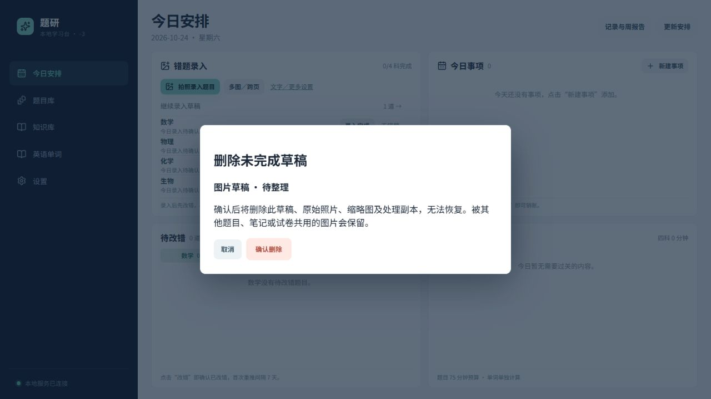
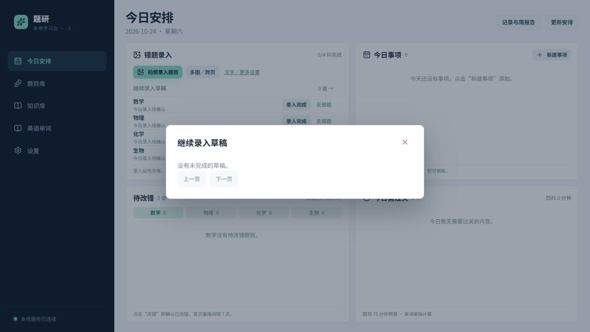

# -3 本地改动：未完成题目草稿可删除

本轮只在本地开发。新版本目录为 `subjects-learning-3/`，在本机 `.git/info/exclude` 中排除，没有暂存、提交或推送。

## 使用变化

- 今日安排 → 继续录入草稿：每条草稿可删除，数量随删除即时刷新。
- 拍题录入页 → 继续未完成的录入：可直接删除草稿。
- 草稿详情页：顶部提供删除入口，确认后返回来源页面。
- 删除前须确认；取消时保留草稿。翻页后删掉该页最后一条，会返回上一页。
- 正在识别、识别失败、缺答案或未选题型的草稿均可删除。后台识别完成或失败都不会使已删除草稿重新出现。
- 后端限定为草稿删除；若另一页面已正式入库，拒绝删除并提示刷新。
- 删除时同时物理清理草稿的原始照片、同题多图、缩略图、组合图、识别处理图、裁图及修复副本，下载接口返回 404。
- 其他有效题目、笔记、答案库或试卷仍引用的图片保留；同图多题最后一个使用者删除时才释放文件。
- 文件被占用时提示尚未完成清理，并持久保存待清理记录；重新操作、服务每分钟维护或重启后继续清理。重新上传相同照片可正常使用，不受旧清理记录影响。

题目保留删除标记和文字版本，移出日常草稿及题目查询；照片文件实际删除。既有备份及旧版目录保持独立，不自动清理。

## 版本与数据

从 -2 使用 SQLite 备份接口建立 -3，并在切换前同步了 -2 的最新数据：12 道题、156 项资产、39 个内容版本。195 个登记文件逐一核对 SHA-256。原 -2 保留。

- 初始快照：`data/backups/version-3-initial/`
- 切换快照：`data/backups/version-3-activation/`
- 正式运行：<http://127.0.0.1:8000/>，健康接口返回 `-3` 和本版数据目录。
- 根目录启动/停止入口优先使用存在的 -3，没有 -3 时使用 -2。

## 验证

| 项目 | 结果 |
| --- | --- |
| 后端全量回归 | 325 项通过 |
| 前端全量回归 | 10 个文件、35 项通过 |
| TypeScript 检查及正式构建 | 通过 |
| 未完成文字草稿、尚未进入录入流程的图片草稿 | 可删除 |
| 已入库题保护、重复删除、未知题目 | 通过 |
| 原图、缩略图、同题多图与历史处理图片物理删除 | 通过 |
| 共用图片保护：其他题目、笔记、答案库、试卷和题目历史版本 | 通过 |
| 文件占用后重试、相同照片重新上传 | 通过 |
| 排队任务不再启动、运行中结果成功/失败不再回填 | 通过 |
| 删掉分页最后一条、草稿数量刷新 | 通过 |
| 隔离网页验收：取消保留文件、确认后草稿归零且原图/缩略图不存在 | 通过 |
| 本地正式服务和页面 | -3，HTTP 200 |

网页验收使用 18003 端口和新建的隔离测试数据库，没有删除正式数据中的草稿。首次草稿界面验收位于 `归档/验证记录/2026-10-24-v3-草稿删除/`，照片清理验收及磁盘核对结果位于 `归档/验证记录/2026-10-24-v3-草稿照片删除/`。打包校验仅要求仍有效的资产，允许已删除草稿的照片不存在。

